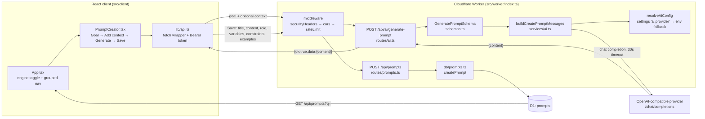

# Architecture

Verified against the committed code at `HEAD`. File references point at the modules that implement each behavior.

## Overview

Prompt Engine + Skills Engine is a Cloudflare-native web application. A single Cloudflare Worker serves the Vite-built React static assets and Hono API routes. Data persists in D1 (SQLite). KV provides rate-limit counters. AI requests are proxied through the Worker to an OpenAI-compatible provider.

## Platform

- Cloudflare Workers + Static Assets (`[assets]` in `wrangler.toml`, binding `ASSETS`)
- D1 (SQLite) for prompts, templates, skills, evaluations, settings, users, sessions
- KV binding `CACHE` for rate-limit counters
- Worker proxies OpenAI-compatible AI requests; no provider secrets reach the browser

## System diagram



## Client structure (`src/client`)

### Entry and auth gate

- `main.tsx` mounts `App.tsx`.
- `App.tsx` holds `user`, `authLoading`, `engine` (`"prompt" | "skill"`), `active` module id, and `settingsOpen`.
- On mount, `getToken()` reads `auth.token` from `localStorage` (`lib/auth.ts`). When a token exists, `api.getMe()` populates the user; a rejected call clears the token. With no user, `Login` renders instead of the workspace.

### Navigation model

Navigation is grouped, not a flat list. `promptModuleGroups` and `skillModuleGroups` in `App.tsx` define two groups per engine and are rendered in that order.

| Engine | Group heading (`id`) | Modules (`id` → title) |
| --- | --- | --- |
| Prompt | `Create your prompt` (`prompt-create`) | `creator` → Creator, `evaluator` → Evaluator, `optimizer` → Optimizer, `library` → Library |
| Prompt | `Advanced tools` (`prompt-advanced`) | `compare` → Compare, `template` → Templates, `research` → Research |
| Skill | `Create your skill` (`skill-create`) | `creator` → Creator, `evaluator` → Evaluator, `optimizer` → Optimizer, `library` → Library |
| Skill | `Advanced tools` (`skill-advanced`) | `search` → Search, `research` → Research, `lab` → Lab |

- The primary journey is the first group of the active engine; advanced tools sit one level below in the same sidebar.
- The journey card (`role="region"`, `aria-labelledby="journey-heading"`) shows the four steps **1. Create → 2. Evaluate → 3. Optimize → 4. Save** and the single primary CTA **Start creating a prompt**, which calls `switchEngine("prompt")`.
- `switchEngine(next)` sets the engine and resets the active module: `"creator"` for Prompt, `"search"` for Skill. Module ids are stable, so all 14 modules stay reachable by click.
- The header engine toggle is a `role="group"` with `aria-label="Engines"`; each button carries `aria-pressed` and `aria-controls="engine-panel"`.
- Content renders through `renderPromptModule(active)` / `renderSkillModule(active)` switches inside the `#engine-panel` section.

### PromptCreator: one flow

`src/client/modules/PromptCreator.tsx` implements a single ordered screen:

1. **Goal** — required `Textarea`; **Generate** is disabled until `goal.trim()` is non-empty.
2. **Add context** — collapsible button with `aria-expanded` and `aria-controls="prompt-context-fields"`, holding optional **Role**, **Variables (comma separated)**, **Constraints**, **Examples**. `parseVariables` splits on commas, trims entries, drops blanks, and caps the list at 50.
3. **Generate** — calls `api.aiGeneratePrompt(goal, buildContext())`.
4. **Result** — live region (`aria-live="polite"`) `Textarea`; **Save**, **Evaluate**, and **Optimize** are disabled until a result exists.

`buildContext()` only assigns `role`, `variables`, `constraints`, `examples` when non-empty, so an untouched context panel produces the goal-only body `{ goal }`.

**Save** posts `title` (goal trimmed to 80 chars, or `Generated prompt`), `content` (the result), plus the same context fields to `POST /api/prompts`.

## Worker request flow: `POST /api/ai/generate-prompt`

`src/worker/index.ts` mounts the middleware chain on `*` — `securityHeaders()` → `corsMiddleware()` → `rateLimitMiddleware()` — before routing `/api/ai` to `src/worker/routes/ai.ts`.

1. **Rate limit** (`middleware/rateLimit.ts`): every `/api/*` call is counted in KV. Mutating methods get 60 requests/minute per `cf-connecting-ip`, reads 240/minute, keyed per UTC minute with a 120 s TTL. Over budget → `429 { ok: false, error: "Rate limit exceeded" }`. Missing `CACHE` fails closed (503) for mutations and open for reads.
2. **Parse** — `c.req.json()`, then `GeneratePromptSchema.safeParse(body)`. Failure → `400 { ok: false, error: <zod message> }`.
3. **Validate** — `GeneratePromptSchema` (`src/worker/schemas.ts`): `goal` (1…20 000 chars), optional `role` (≤20 000), optional `variables` (array of non-empty strings, ≤50), optional `constraints`, optional `examples`.
4. **Compose** — `buildCreatePromptMessages(goal, { role, variables, constraints, examples })` in `src/worker/services/ai.ts`.
5. **Resolve provider** — `chatCompletion` calls `resolveAiConfig(env)`: reads the settings table, prefers a validated `ai.provider` JSON value `{ baseUrl, model }`, otherwise falls back to `OPENAI_BASE_URL` / `OPENAI_MODEL` (defaults `https://opencode.ai/zen/v1`, `deepseek-v4.1-flash-free`).
6. **Call provider** — `POST ${baseUrl}/chat/completions` with `{ model, messages, temperature: 0.7, max_tokens: 1200, stream: false }` and a 30 s timeout (`lib/fetchTimeout.ts`). `Authorization` is attached only when the target origin is the trusted env origin (or the key came from settings), so a settings-overridden base URL never receives the operator key.
7. **Respond** — `{ ok: true, data: { content } }`, where `content` is `choices[0].message.content` (empty string when absent).
8. **Errors** — any thrown outbound error goes through `mapOutboundError` → `502 { ok: false, error: "Upstream AI error" }`; details are logged server-side only. Unhandled errors hit the `app.onError` handler → `500 { ok: false, error: "Internal server error" }`.

Note: the route itself performs no Bearer-token check (no auth middleware is mounted on `/api/ai`). The client still sends `Authorization: Bearer <token>` on every request; auth-gated endpoints are `/api/auth/me`, `/api/auth/change-password`, `/api/auth/users`, all `/api/settings/*`, and `/api/ai/models` + `/api/ai/test`.

## Message composition (`src/worker/services/ai.ts`)

`buildCreatePromptMessages(goal, ctx)` returns exactly two messages:

- `system`: "You are an expert prompt engineer. Generate a high-quality prompt for the user's goal. Return only the prompt text."
- `user`: `composeGenerationUserMessage(goal, ctx)`.

`composeGenerationUserMessage` appends labeled sections in a fixed order, only when the value is present and non-empty:

```
<goal>
Role: <role>
Variables: <a, b, c>
Constraints: <constraints>
Examples: <examples>
```

The variables array is joined with `", "`. With no context (or an all-empty context) the function returns the goal string alone, so the goal-only path is unchanged.

Structured-output routes reuse `parseJsonFromText` / `parseModelJson` to validate model JSON against Zod schemas and degrade malformed output to `null` instead of surfacing raw text as structured data.

## Save path to D1

1. `api.createPrompt(data)` → `POST /api/prompts` with `{ title, content, role?, variables?, constraints?, examples?, tags? }`.
2. `routes/prompts.ts` validates with `PromptInputSchema` (same bounded-string limits; `title` and `content` required) → `400` on failure.
3. `db/prompts.ts#createPrompt` inserts one row: `id` (`newId()`), `version = 1`, `created_at` / `updated_at` (`nowIso()`); `variables` and `tags` are stored as JSON strings, absent optional fields as `NULL`.
4. Response `201 { ok: true, data: <Prompt> }`; `rowToPrompt` maps snake_case columns back to the camelCase `Prompt` type and parses the JSON arrays.
5. The Library module reads `GET /api/prompts?q=…` (search matches `title` or `content`, `ORDER BY updated_at DESC`, default limit 100).

The generated content and the context fields are therefore persisted together; D1 never stores AI provider responses implicitly — only an explicit Save writes a row.

## API surface

Framework: Hono. Routes are mounted in `src/worker/index.ts`:

- `/api/health`, `/api/prompts`, `/api/templates`, `/api/skills`, `/api/evaluations`, `/api/settings`, `/api/ai`, `/api/auth`, `/api/search`
- JSON request/response with the shared envelope `{ ok: true, data } | { ok: false, error }`
- Unmatched `/api/*` returns JSON `404` (never the SPA shell); all other paths fall through to `ASSETS`

See [api.md](api.md) for the endpoint reference.

## D1 schema

`migrations/0001_init.sql`: `prompts`, `templates`, `skills`, `evaluations`, `settings`.
`migrations/0002_auth.sql`: `users`, `sessions` (+ indexes `idx_sessions_user_id`, `idx_sessions_expires_at`).

## AI provider integration pattern

- OpenAI-compatible `chat/completions` endpoint, non-streaming.
- Config from env: `OPENAI_BASE_URL` (default `https://opencode.ai/zen/v1`), `OPENAI_MODEL` (default `deepseek-v4.1-flash-free`), optional `OPENAI_API_KEY`.
- Optional `AI_PROVIDER_ALLOWLIST` (comma-separated `https://` origins) constrains settings-based provider overrides.
- User-writable `ai.provider` (`{ baseUrl, model }`) is validated as a public HTTPS URL (`services/aiProvider.ts`); malformed values fall back to the env config.
- Worker-side calls only; no secrets in client code.

## Security posture

- CSP via `secure-headers`: `default-src 'self'`, `script-src 'self'`, `style-src 'self' 'unsafe-inline'`, `img-src 'self' data:`, `connect-src 'self'`.
- CORS allows the dev origins (`localhost`/`127.0.0.1` on 5173 and 8787) and same-origin requests; allowed headers are `Content-Type`, `Authorization`, `X-Correlation-ID`.
- All request bodies are bounded by Zod (`MAX_TEXT` 20 000, `MAX_TITLE` 300, arrays ≤50, JSON blobs ≤32 KB).
- Passwords are PBKDF2-SHA256 (100 000 iterations, 16-byte salt); sessions are opaque tokens in D1 with `expires_at`.

## Folder structure

- `src/client` — React frontend (modules, components, `lib/api.ts`)
- `src/worker` — Cloudflare Worker: `routes`, `services`, `db`, `middleware`, `lib`
- `src/shared` — shared TypeScript types
- `migrations` — D1 migrations
- `tests` — unit / integration / e2e
- `docs` — documentation and evidence
- `AGENTS.md` in every folder

## Verified sources

`src/client/App.tsx`, `src/client/modules/PromptCreator.tsx`, `src/client/lib/api.ts`, `src/worker/index.ts`, `src/worker/routes/ai.ts`, `src/worker/routes/prompts.ts`, `src/worker/services/ai.ts`, `src/worker/services/aiProvider.ts`, `src/worker/schemas.ts`, `src/worker/db/prompts.ts`, `src/worker/middleware/{rateLimit,cors,security}.ts`, `migrations/0001_init.sql`, `migrations/0002_auth.sql`.
